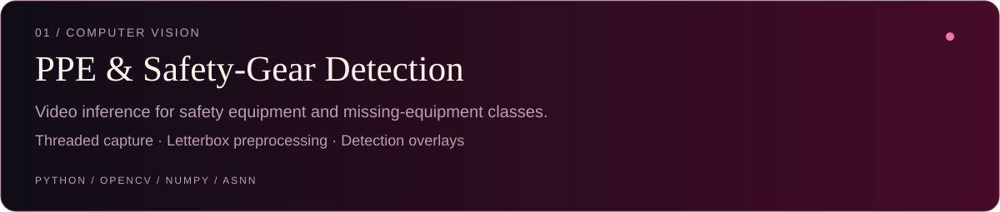
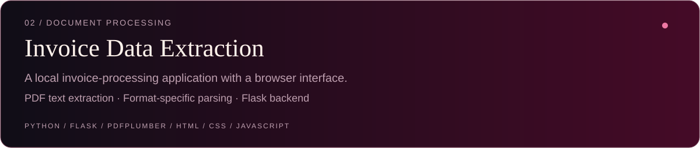
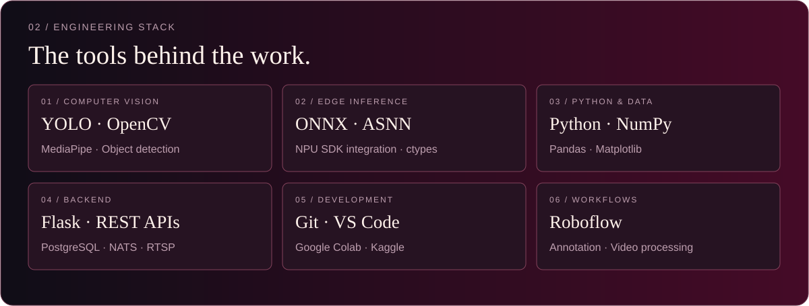

<picture>
  <source media="(prefers-color-scheme: dark)" srcset="./dark.svg">
  <source media="(prefers-color-scheme: light)" srcset="./light.svg">
  
</picture>

  <a href="https://portfolio-krish-1208.vercel.app/">Portfolio</a> &nbsp; / &nbsp;
  <a href="mailto:krishprajapati280@gmail.com">Email</a> &nbsp; / &nbsp;
  <a href="https://github.com/Krishprajapati28?tab=repositories">Repositories</a>

## Hello, I'm Krish.

I build **computer vision applications, offline document-processing tools, and Python backend services**. My work connects model inference with the preprocessing, runtime integration, and application logic needed to solve practical problems.

Based in **Gandhinagar, Gujarat, India**, I focus on video-processing pipelines, safety detection, and deploying AI on resource-constrained hardware.

<b>What I build</b>

- **Computer vision applications** — object detection, PPE monitoring, and video analysis.
- **Edge AI pipelines** — model-format integration, NPU runtime bindings, and inference preprocessing.
- **Document-processing tools** — invoice field extraction and OCR workflows.
- **Python backend services** — Flask APIs, structured data processing, and application integration.
- **Video and event pipelines** — RTSP inputs, threaded frame processing, and event-driven systems.

---

## Selected work
*From model output to useful applications.*

[Repository](https://github.com/Krishprajapati28/Safety-PPE-krish-) · [Inference code](https://github.com/Krishprajapati28/Safety-PPE-krish-/blob/main/video%20%281%29.py)

[Repository](https://github.com/Krishprajapati28/invoice-ocr) · [Setup & usage](https://github.com/Krishprajapati28/invoice-ocr#readme)

---

<picture>
  <source media="(prefers-color-scheme: dark)" srcset="./assets/stack-dark.svg">
  <source media="(prefers-color-scheme: light)" srcset="./assets/stack-light.svg">
  
</picture>

---

## A year of building.
*My contribution activity, one square at a time.*

  <picture>
    <source media="(prefers-color-scheme: dark)" srcset="https://raw.githubusercontent.com/Krishprajapati28/Krishprajapati28/output/github-snake-dark.svg">
    <source media="(prefers-color-scheme: light)" srcset="https://raw.githubusercontent.com/Krishprajapati28/Krishprajapati28/output/github-snake.svg">
    
  </picture>

---

## Let's build something useful.

Interested in **AI/ML, computer vision, and Python backend opportunities**.
I enjoy working on reliable video inference, offline AI, and practical embedded deployment.

**[Portfolio](https://portfolio-krish-1208.vercel.app/) · [Email me](mailto:krishprajapati280@gmail.com) · [GitHub](https://github.com/Krishprajapati28)**

Practical AI. Thoughtful engineering.
